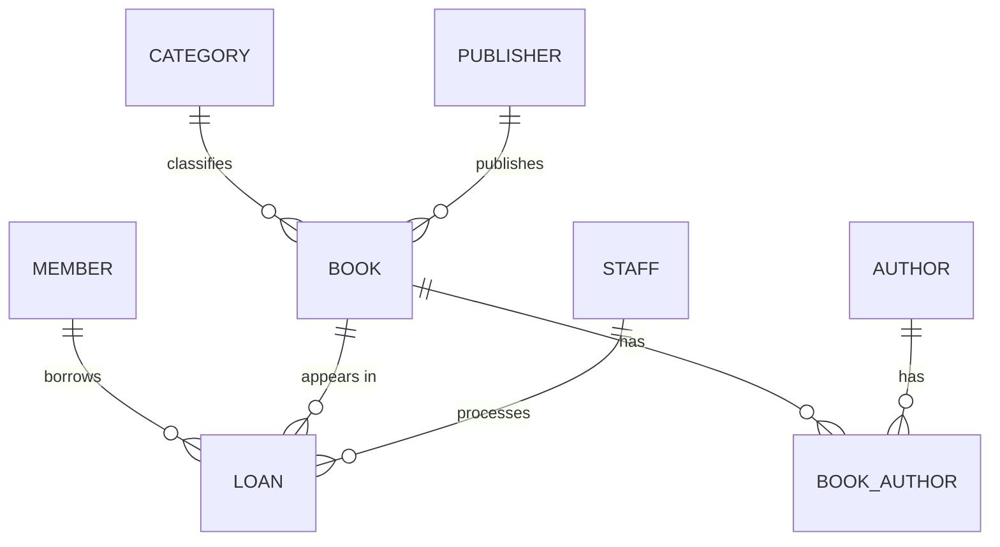

# Advanced Database Systems Portfolio
**Course:** MIT 8103

**Student:** Bright Kwena Ekwueme

**Matric No:** 2026/A/MIT/0921

**Case Study:** Miva Community Library — Library Management System

# Portfolio 1: Database Design and Modelling

## 1. Case Study Description
The Miva Community Library is a public library system designed to keep track of books and the members who borrow them.

The main people who will use the database are library staff/librarians, registered members, and administrators.

- **Users of the database:** librarians (staff), library members, and administrators
- **Major data stored:** books, authors, categories, publishers, members, loans, returns, and fines
- **Key operations:** search the catalogue, borrow a book, return a book, calculate overdue fines, track availability, and generate loan reports

The major things the system should be able to do include searching for books, recording when a member borrows a book, processing returns, calculating overdue fines, checking which books are available, and producing loan reports.

## 2. Entities and Relationships
| Entity | Description | Relationship |
|---|---|---|
| **MEMBER** | Stores information about registered library members | A member can have many loans (1:M) |
| **BOOK** | Contains information about books in the library | A book can appear in many loan records |
| **AUTHOR** | Stores information about book authors | M:M with BOOK through BOOK_AUTHOR |
| **BOOK_AUTHOR** | Junction table used to connect books and authors | Resolves the many-to-many relationship |
| **CATEGORY** | Stores the different book categories or subjects | One category can contain many books (1:M) |
| **PUBLISHER** | Stores information about publishers | One publisher can publish many books (1:M) |
| **STAFF** | Contains information about librarians/staff | One staff member can process many loans (1:M) |
| **LOAN** | Records borrowing and returning transactions | Connects MEMBER, BOOK and STAFF |

## 3. ER Diagram



## 4. Keys and Constraints

Each table has a primary key that uniquely identifies each record. The design mainly uses surrogate IDs such as `MemberID`, `BookID`, and similar identifiers with `AUTO_INCREMENT`.

Foreign keys are used to connect related tables:

* `Loan.BookID → Book.BookID`
* `Loan.MemberID → Member.MemberID`
* `Loan.StaffID → Staff.StaffID`
* `Book.CategoryID → Category.CategoryID`
* `Book.PublisherID → Publisher.PublisherID`

The database also uses UNIQUE constraints for fields where duplicate values should not be allowed:

* `Book.ISBN`
* `Member.Email`
* `Staff.Email`
* `Category.CategoryName`
* `Publisher.PublisherName`

For example, two members should not have the same email address.

I also used CHECK constraints to make sure the number of copies cannot become negative. Therefore:

* `TotalCopies >= 0`
* `AvailableCopies >= 0`

Important fields are also set to NOT NULL where necessary. For values such as fines, a default value of `0.00` can be used when no fine has been recorded.

## 5. Normalisation

I normalised the database to reduce unnecessary duplication and make the data easier to maintain.

**1NF — First Normal Form**

For 1NF, each field should contain a single atomic value.

A book can have more than one author, so I did not store multiple authors in one field separated by commas. Instead, I created the BOOK_AUTHOR table to connect books with their authors.

This keeps the data properly structured and makes it easier to search and manage.

**2NF — Second Normal Form**

For 2NF, there should be no partial dependency on only part of a composite key.

The main composite key in this design is in `BOOK_AUTHOR`, which uses `(BookID, AuthorID)`.

Since there are no other non-key attributes in this table, there is no partial dependency.

**3NF — Third Normal Form**

For 3NF, non-key attributes should depend on the primary key and not on another non-key attribute.

For example, `CategoryName` depends on `CategoryID`, rather than directly depending on `BookID`. Because of this, category information is kept in a separate CATEGORY table instead of being repeated for every book.

The same approach is used for publishers. This reduces duplication and helps prevent update anomalies.

## 6. How to Run the Database

The database can be run using MySQL Workbench.

**Step 1 — Create the Database Structure**

Run:

```sql
library_schema.sql
```

This creates the database and the required tables.

**Step 2 — Add Sample Data**

Run:

```sql
sample_data.sql
```

This inserts the sample records into the tables.

**Step 3 — Verify the Tables**

To check that the tables were created successfully:

```sql
SHOW TABLES;
```

To view the records in the Member table:

```sql
SELECT * FROM Member;
```

These queries can be used to confirm that the database structure and sample data were loaded correctly.

## 7. Evidence

The project evidence is provided in the `screenshots/` folder.

The screenshots include:

* Database/schema creation output
* The Schemas panel showing the 8 tables
* SQL query results
* Evidence that the database was successfully created and tested

# Portfolio 2: Query Processing and Optimisation

### Queries
Five queries were written against library_db demonstrating JOINs (Q1),
GROUP BY aggregation (Q2, Q5), date functions for overdue detection (Q3),
and a subquery (Q4). Results in screenshots q1–q4.

### Optimisation
EXPLAIN was run before and after adding indexes:
- Before: type=ALL, key=NULL, rows=3 (full table scan)
- After CREATE INDEX idx_member_email: type=ref, key=idx_member_email, rows=1
- Same improvement on Loan.MemberID via idx_loan_member.

### Analysis
Indexes trade small storage/write cost for faster lookups by letting MySQL
examine fewer rows. With small tables the millisecond saving is invisible,
so performance is compared using execution plans (rows examined), which is
the standard approach.


# Portfolio 3: Transactions and Concurrency

## 1. Commit and Rollback

### Demo 1: COMMIT

For the first demo, I borrowed a book by inserting a loan record and reducing the available copies within a transaction, then executed `COMMIT`.

Both changes were saved successfully. The loan appeared in the database, and the available copies of *Foundation* decreased from 2 to 1.

### Demo 2: ROLLBACK

For the second demo, I repeated the borrowing process but executed `ROLLBACK` instead.

Although the `INSERT` and `UPDATE` statements each reported `1 row affected`, the verification queries confirmed that the loan count remained at 5 and the book's available copies remained at 3.

This demonstrated that `ROLLBACK` reverses uncommitted changes, restoring the database to its previous state.

### Demo 3: Handling Errors

For the third demo, I started a transaction and reduced a book's available copies. I then attempted to insert a member with a duplicate email address, which failed because of the `UNIQUE` constraint.

I observed that MySQL did not automatically undo the earlier book update. The transaction remained open, so I had to execute `ROLLBACK` manually.

After the rollback, the book's available copies returned to their original value.

**Key takeaway:** A failed SQL statement does not necessarily roll back an entire transaction. Explicit transaction handling is important when an operation fails.

---

## 2. Isolation

I opened two query tabs in MySQL Workbench to simulate two concurrent users.

1. In **Tab A**, I started a transaction and updated the phone number of Member 1 without committing the change.
2. In **Tab B**, I set the transaction isolation level to `READ COMMITTED` and queried the same phone number.
3. Tab B returned the old phone number because Tab A's change was still uncommitted.
4. I returned to Tab A and executed `COMMIT`.
5. When I queried the phone number again in Tab B, the new value appeared.

This demonstrated that under `READ COMMITTED`, a transaction cannot read another transaction's uncommitted changes.

However, successive reads of the same row can return different values if another transaction commits an update between those reads. This is known as a **non-repeatable read**.

I also learned that MySQL's default InnoDB isolation level is `REPEATABLE READ`. Under this isolation level, consistent reads within the same transaction normally continue to see the same committed snapshot.

---

## 3. Concurrency Control

For this demonstration, I used two sessions to simulate concurrent access to the same book, identified by `BookID = 2`.

1. In **Tab A**, I executed `SELECT ... FOR UPDATE` to lock the target row.
2. I updated the available copies but did not commit the transaction.
3. In **Tab B**, I attempted another `SELECT ... FOR UPDATE` on the same row.
4. The second query waited because Tab A held a conflicting row lock.
5. Once I committed the transaction in Tab A, Tab B's query completed and returned the updated value.

This demonstrated how InnoDB's row-level locking helps coordinate concurrent operations on shared data.

For a library system, this is important because two librarians should not independently process conflicting updates based on the same available-copy count.

**Key takeaway:** Row locks help prevent conflicting transactions from modifying the same data simultaneously. However, the application must still implement appropriate checks and updates to prevent lending more copies than are available.

---

## 4. Key Learning

This portfolio helped me understand three important database concepts:

- **Atomicity:** Transactions group SQL statements so that changes can be committed together or undone through rollback.
- **Isolation:** Isolation levels determine how concurrent transactions observe database changes and help control phenomena such as non-repeatable reads.
- **Concurrency control:** Row-level locks, including those acquired through `SELECT ... FOR UPDATE`, coordinate access to shared records and make conflicting operations wait when necessary.

These capabilities are supported by **InnoDB**, MySQL's default storage engine, which provides transaction support, row-level locking, and other mechanisms for maintaining data consistency.

---

## 5. Evidence

Screenshots documenting the practical demonstrations are available in the following folder:

`portfolio-3-transactions-concurrency/screenshots/`

The screenshots provide evidence of the transaction operations, rollback verification, isolation behavior, and row-locking demonstrations.


# Portfolio 4: NoSQL and Advanced Data Models

## 1. Data Model

I remodelled the same library management system in MongoDB, a document-oriented NoSQL database, to compare it with the relational database design from Portfolio 1.

The MongoDB implementation uses three collections:

### Books Collection

Each document stores the book's details in a single structure, including:

- `title`, `ISBN`, `year`, and `publisher`
- An embedded `category` object
- An embedded `authors` array
- A `copies` object containing `total` and `available`
- A `formats` array

Unlike a traditional relational design, embedded authors and categories eliminate the need for separate junction tables when retrieving a book's complete details.

### Members Collection

The `members` collection stores one document per library member, mirroring the structure and purpose of the `Member` table in MySQL.

### Loans Collection

The `loans` collection stores borrowing records and references a book's `_id` using an `ObjectId`, alongside the member's email address.

These references connect loan records to books and members. Unlike MySQL foreign keys, MongoDB does not automatically enforce referential integrity for these references.

---

## 2. Queries Demonstrated

I executed three filter queries against the `books` collection to demonstrate MongoDB's flexibility when working with embedded documents and arrays.

### Query 1: Filter by Embedded Category

```javascript
db.books.find({ "category.name": "Fiction" })
```

**Result:** Returned 2 books.

This query demonstrates dot notation, which allows MongoDB to filter documents using a field inside an embedded object.

### Query 2: Filter by Author Name

```javascript
db.books.find({ "authors.name": "George Orwell" })
```

**Result:** Returned *1984*.

This query demonstrates how MongoDB can match a field inside an embedded array of author documents.

### Query 3: Filter by Book Format

```javascript
db.books.find({ "formats": "ebook" })
```

**Result:** Returned 3 books.

This query demonstrates MongoDB's ability to match a value contained in an array without requiring a separate table for book formats.

### Query 4: Join Loans with Books Using `$lookup`

I also performed an aggregation using `$lookup` to combine loan records with their corresponding book documents and display the book title alongside each loan.

```javascript
db.loans.aggregate([
  {
    $lookup: {
      from: "books",
      localField: "book_id",
      foreignField: "_id",
      as: "book_details"
    }
  },
  {
    $unwind: "$book_details"
  },
  {
    $project: {
      _id: 1,
      member_email: 1,
      book_title: "$book_details.title"
    }
  }
])
```

**Purpose:** This demonstrates that MongoDB supports relational-style joins through aggregation, even though it primarily uses a document-oriented data model.

*Note: The `$lookup` example assumes that the loan collection uses `book_id` as the reference field and that the member email field is named `member_email`. Adjust these names if your actual documents use different field names.*

---

## 3. Suitability Analysis

### Advantages of MongoDB

The document model is a natural fit for a library catalogue because **data that is read together can be stored together**.

Retrieving a book with its authors, category, and copy counts can require a single document read in MongoDB. In the equivalent normalized MySQL design, the same information may require querying four tables:

- `Book`
- `Author`
- `Book_Author`
- `Category`

This can involve three `JOIN` operations.

MongoDB also supports a flexible schema. Different book documents can contain additional fields, such as `ratings` or `edition`, without requiring a table-wide schema change using `ALTER TABLE`.

### Limitations and Trade-offs

The main trade-off is **denormalisation**.

For example, the category name `Fiction` may be duplicated across multiple book documents. Renaming the category could therefore require updating several documents instead of changing one row in a normalized category table.

MongoDB also does not enforce foreign-key constraints automatically. Referential integrity must be maintained through application logic or other validation mechanisms.

### MongoDB vs. MySQL

| Feature | MongoDB | MySQL |
|---|---|---|
| Data model | Document-oriented | Relational |
| Schema | Flexible | Structured schema |
| Related data | Embedded documents and references | Tables and foreign keys |
| Joins | Aggregation with `$lookup` | SQL `JOIN` operations |
| Referential integrity | Application-level enforcement for references | Foreign-key constraints |
| Best fit in this project | Flexible catalogue reads | Consistent transactions and relational reporting |

### Conclusion

The two database models complement each other rather than one completely replacing the other.

MongoDB is suitable for a flexible library catalogue where related information can be embedded in a document. MySQL remains a strong choice for operations that depend on relational integrity, enforced foreign keys, and complex reporting.

The most appropriate database depends on the application's access patterns, consistency requirements, and data relationships.

---

## 4. Evidence

The screenshots documenting the MongoDB implementation and queries are available in the `portfolio-4-nosql/` folder.

| Screenshot | Evidence |
|---|---|
| `01-books-documents.png` | Book documents and embedded data |
| `02-members.png` | Members collection |
| `03-loans.png` | Loan documents and references |
| `04-query-fiction.png` | Filtering books by category |
| `05-query-orwell.png` | Filtering books by author |
| `06-query-ebook.png` | Filtering books that are digital |
| `07-lookup-join.png` | Aggregation using `$lookup` |

These screenshots provide evidence of the document structure, query results, and join demonstration performed during the practical exercise.
