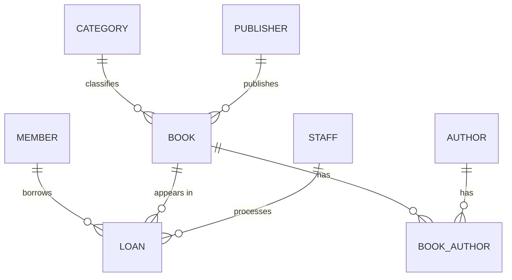

# Advanced Database Systems Portfolio
**Course:** MIT 8103

**Student:** Bright Kwena Ekwueme

**Matric No:** 2026/A/MIT/0921

**Case Study:** Miva Community Library — Library Management System

## 1. Case Study Description
The Miva Community Library is a public library system designed to keep track of books and the members who borrow them.

The main people who will use the database are library staff/librarians, registered members, and administrators.

- **Users of the database:** librarians (staff), library members, and administrators
- **Major data stored:** books, authors, categories, publishers, members, loans, returns, and fines
- **Key operations:** search the catalogue, borrow a book, return a book, calculate overdue fines, track availability, and generate loan reports

The major things the system should be able to do include searching for books, recording when a member borrows a book, processing returns, calculating overdue fines, checking which books are available, and producing loan reports.

## 2. Entities and Relationships
| Entity | Description | Relationship |
|---|---|---|
| **MEMBER** | Stores information about registered library members | A member can have many loans (1:M) |
| **BOOK** | Contains information about books in the library | A book can appear in many loan records |
| **AUTHOR** | Stores information about book authors | M:M with BOOK through BOOK_AUTHOR |
| **BOOK_AUTHOR** | Junction table used to connect books and authors | Resolves the many-to-many relationship |
| **CATEGORY** | Stores the different book categories or subjects | One category can contain many books (1:M) |
| **PUBLISHER** | Stores information about publishers | One publisher can publish many books (1:M) |
| **STAFF** | Contains information about librarians/staff | One staff member can process many loans (1:M) |
| **LOAN** | Records borrowing and returning transactions | Connects MEMBER, BOOK and STAFF |

## 3. ER Diagram



## 4. Keys and Constraints

Each table has a primary key that uniquely identifies each record. The design mainly uses surrogate IDs such as `MemberID`, `BookID`, and similar identifiers with `AUTO_INCREMENT`.

Foreign keys are used to connect related tables:

* `Loan.BookID → Book.BookID`
* `Loan.MemberID → Member.MemberID`
* `Loan.StaffID → Staff.StaffID`
* `Book.CategoryID → Category.CategoryID`
* `Book.PublisherID → Publisher.PublisherID`

The database also uses UNIQUE constraints for fields where duplicate values should not be allowed:

* `Book.ISBN`
* `Member.Email`
* `Staff.Email`
* `Category.CategoryName`
* `Publisher.PublisherName`

For example, two members should not have the same email address.

I also used CHECK constraints to make sure the number of copies cannot become negative. Therefore:

* `TotalCopies >= 0`
* `AvailableCopies >= 0`

Important fields are also set to NOT NULL where necessary. For values such as fines, a default value of `0.00` can be used when no fine has been recorded.

## 5. Normalisation

I normalised the database to reduce unnecessary duplication and make the data easier to maintain.

**1NF — First Normal Form**

For 1NF, each field should contain a single atomic value.

A book can have more than one author, so I did not store multiple authors in one field separated by commas. Instead, I created the BOOK_AUTHOR table to connect books with their authors.

This keeps the data properly structured and makes it easier to search and manage.

**2NF — Second Normal Form**

For 2NF, there should be no partial dependency on only part of a composite key.

The main composite key in this design is in `BOOK_AUTHOR`, which uses `(BookID, AuthorID)`.

Since there are no other non-key attributes in this table, there is no partial dependency.

**3NF — Third Normal Form**

For 3NF, non-key attributes should depend on the primary key and not on another non-key attribute.

For example, `CategoryName` depends on `CategoryID`, rather than directly depending on `BookID`. Because of this, category information is kept in a separate CATEGORY table instead of being repeated for every book.

The same approach is used for publishers. This reduces duplication and helps prevent update anomalies.

## 6. How to Run the Database

The database can be run using MySQL Workbench.

**Step 1 — Create the Database Structure**

Run:

```sql
library_schema.sql
```

This creates the database and the required tables.

**Step 2 — Add Sample Data**

Run:

```sql
sample_data.sql
```

This inserts the sample records into the tables.

**Step 3 — Verify the Tables**

To check that the tables were created successfully:

```sql
SHOW TABLES;
```

To view the records in the Member table:

```sql
SELECT * FROM Member;
```

These queries can be used to confirm that the database structure and sample data were loaded correctly.

## 7. Evidence

The project evidence is provided in the `screenshots/` folder.

The screenshots include:

* Database/schema creation output
* The Schemas panel showing the 8 tables
* SQL query results
* Evidence that the database was successfully created and tested
